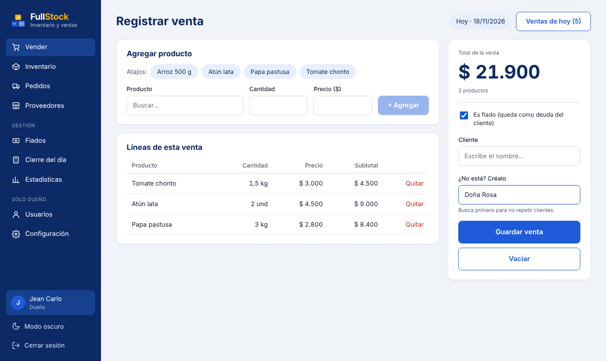
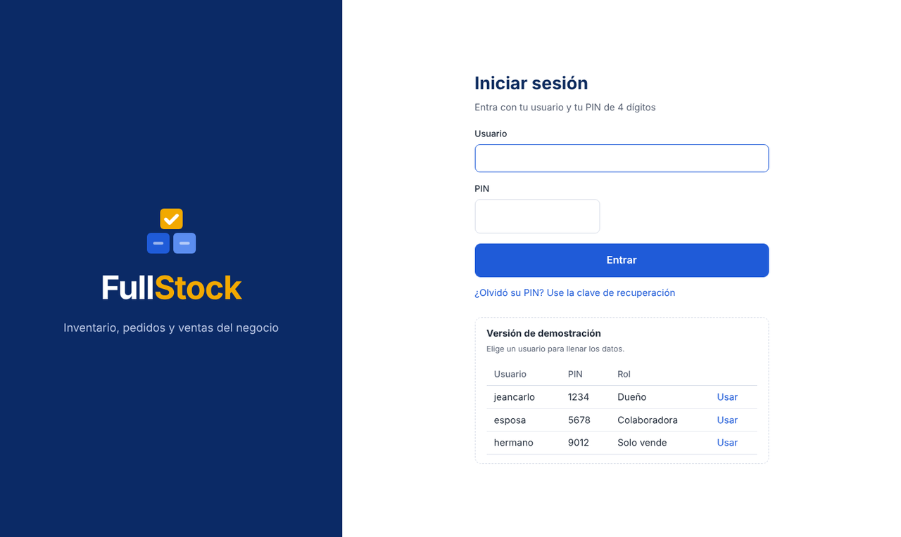
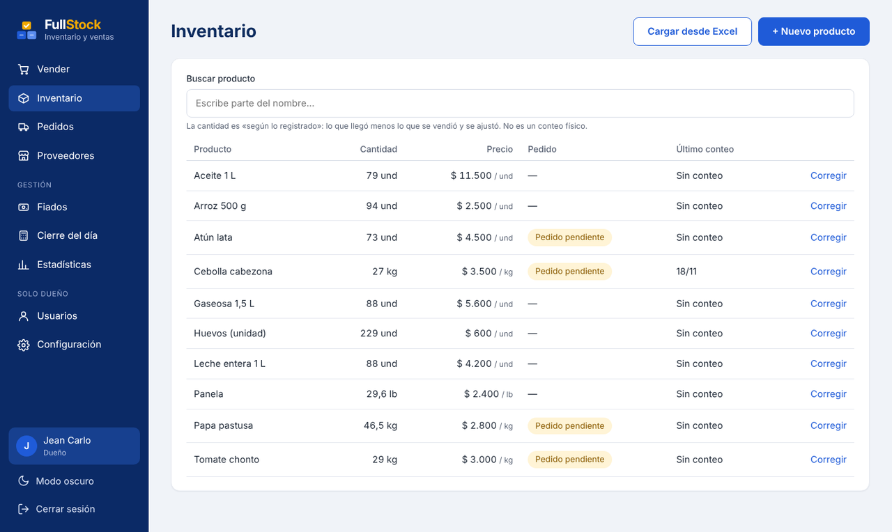
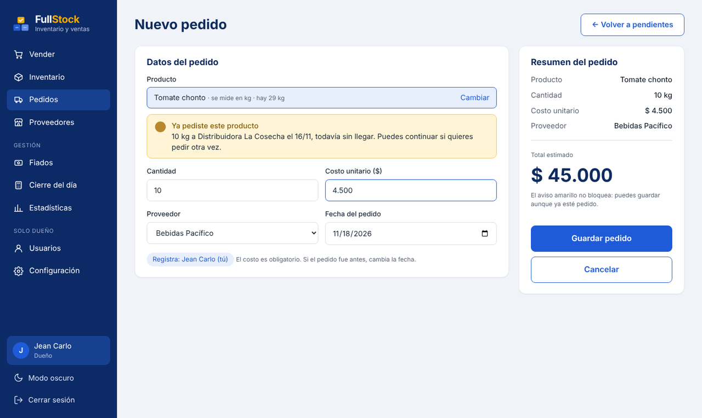
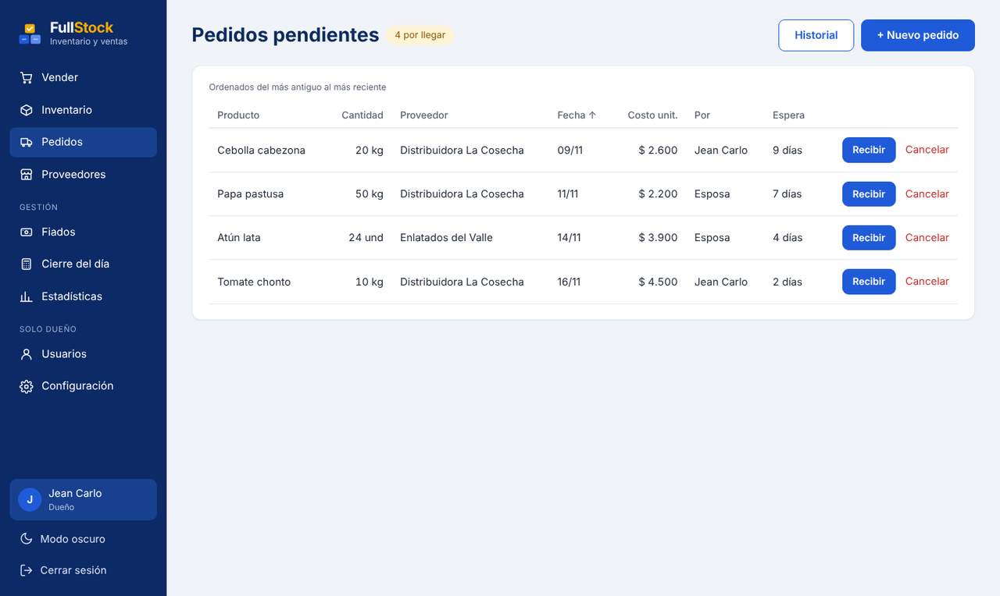
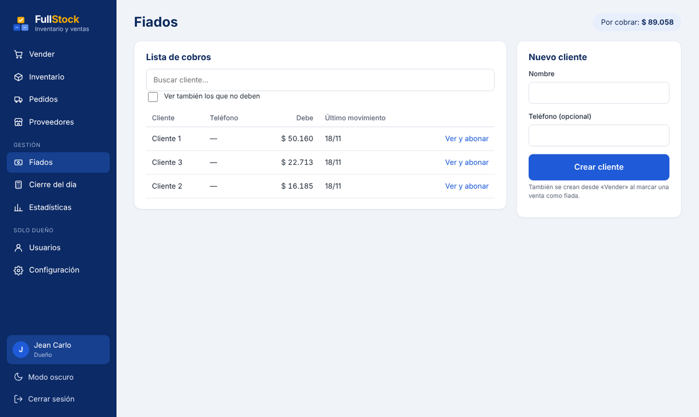
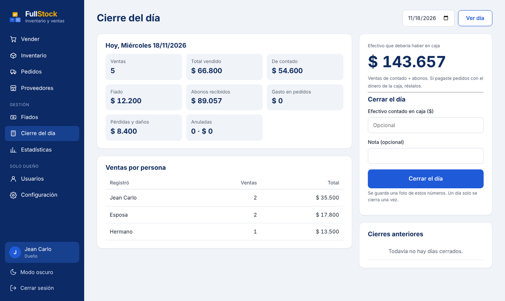
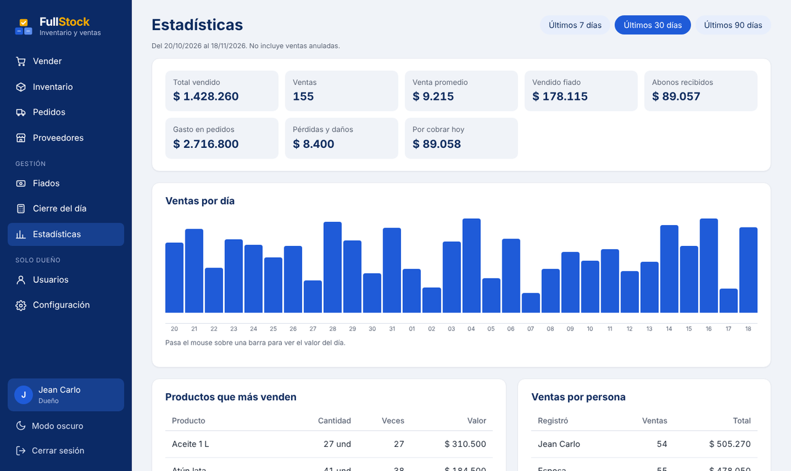
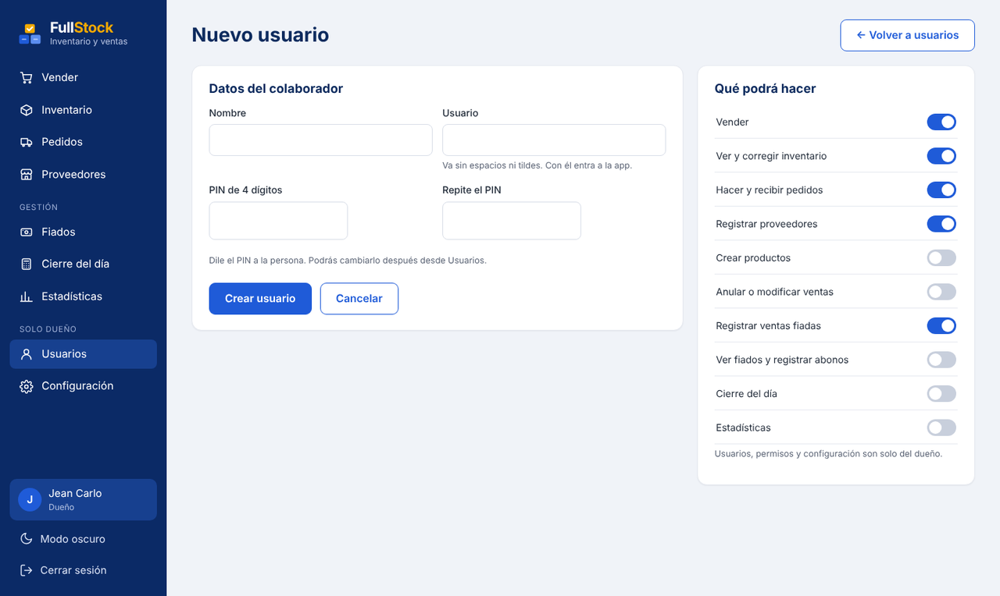
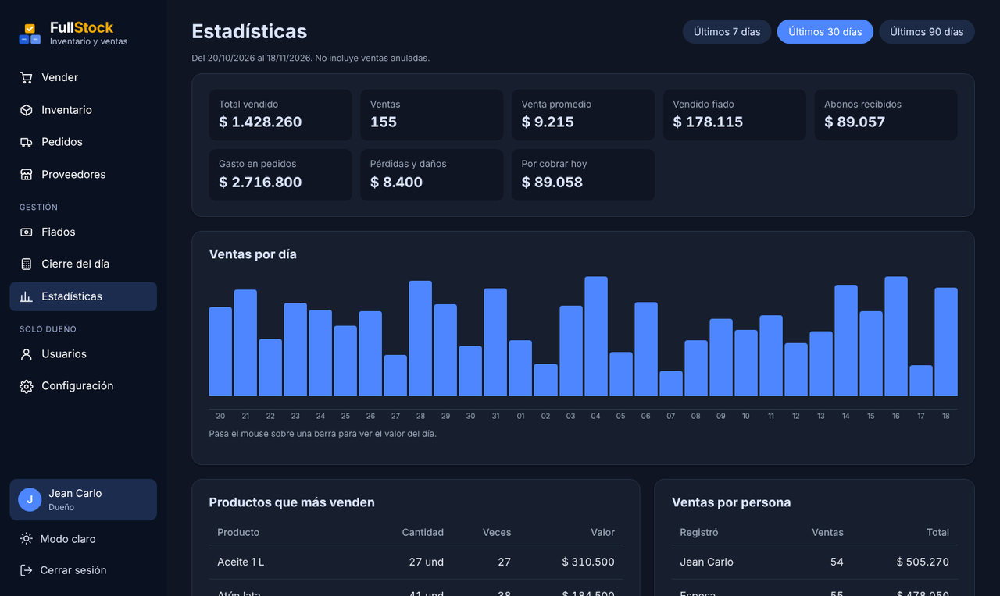

<div align="center">


# FullStock

**Inventario, ventas, pedidos y fiados para tiendas de barrio.**<br>
Sin cuadernos, sin hardware extra y pensado para quien nunca ha usado un programa de gestión.

[](https://github.com/DogeAAPL/ElPapayal/actions/workflows/ci.yml)


**[Ver la demostración en línea →](https://fullstock-hi71.onrender.com)**

</div>

<p align="center">
  
</p>

---

## Contenido

- [El problema](#el-problema)
- [Qué hace](#qué-hace)
- [Capturas](#capturas)
- [Probar la demostración](#probar-la-demostración)
- [Cómo está hecho](#cómo-está-hecho)
- [Empezar a desarrollar](#empezar-a-desarrollar)
- [Pruebas y calidad](#pruebas-y-calidad)
- [Despliegue](#despliegue)
- [Estructura del proyecto](#estructura-del-proyecto)
- [Estado](#estado)

## El problema

Una tienda de barrio con más de 10 años de operación, tres personas atendiendo y unos 200 clientes al día lleva todo en cuadernos. Eso causa tres problemas:

- **No se sabe qué hay** ni cuánto se pierde por vencimiento o daño.
- **Se olvida a quién se le fió** y cuánto debe.
- **Los tres piden a los proveedores** sin saber qué pidieron los otros, y llega mercancía de más.

FullStock reemplaza los cuadernos con una página web sencilla que corre en el computador que la tienda ya tiene.

## Qué hace

| | Módulo | Lo que resuelve |
|:-:|---|---|
| 🛒 | **Vender** | Registro rápido con búsqueda y atajos a los productos más vendidos. Acepta kilos y libras con coma decimal y ventas fiadas. Las ventas se anulan o corrigen sin perder el historial. |
| 📦 | **Inventario** | Existencias según lo registrado, correcciones con motivo (conteo, daño, pérdida), aviso de productos duplicados y carga masiva desde Excel o CSV. |
| 🚚 | **Pedidos** | Avisa si alguien ya pidió el producto. Al recibir suma al inventario y calcula el gasto; si llega menos, registra el faltante. Un pedido se recibe una sola vez. |
| 🏪 | **Proveedores** | Directorio con los pedidos pendientes de cada uno. |
| 💵 | **Fiados** | Lista de cobros ordenada por deuda, historial por cliente, abonos y límite de deuda configurable. |
| 🧮 | **Cierre del día** | Contado, fiado, abonos, gastos y pérdidas. Compara el efectivo esperado con el contado en caja. |
| 📊 | **Estadísticas** | Ventas por día, productos que más venden y ventas por persona en 7, 30 o 90 días. |
| 👥 | **Usuarios y permisos** | Cada persona entra con su PIN. El dueño activa o desactiva cada función por colaborador y todo queda registrado a nombre de quien lo hizo. |
| ⚙️ | **Configuración** | Inactividad, bloqueo por intentos fallidos, ventas sin existencia, límite de deuda y respaldos. |
| 🌙 | **Modo oscuro** | Cada usuario elige claro, oscuro o igual que el computador. |

## Capturas

<table>
  <tr>
    <td width="50%"><br><sub><b>Inicio de sesión</b> con usuarios de demostración</sub></td>
    <td width="50%"><br><sub><b>Inventario</b> con pedidos pendientes y último conteo</sub></td>
  </tr>
  <tr>
    <td><br><sub><b>Nuevo pedido</b>: avisa si el producto ya fue pedido</sub></td>
    <td><br><sub><b>Pedidos pendientes</b> ordenados por espera</sub></td>
  </tr>
  <tr>
    <td><br><sub><b>Fiados</b>: lista de cobros y total por cobrar</sub></td>
    <td><br><sub><b>Cierre del día</b> con efectivo esperado</sub></td>
  </tr>
  <tr>
    <td><br><sub><b>Estadísticas</b> por periodo</sub></td>
    <td><br><sub><b>Permisos</b> por colaborador</sub></td>
  </tr>
  <tr>
    <td colspan="2"><br><sub><b>Modo oscuro</b></sub></td>
  </tr>
</table>

## Probar la demostración

👉 **https://fullstock-hi71.onrender.com**

| Usuario | PIN | Rol |
|---|---|---|
| `jeancarlo` | `1234` | Dueño: tiene acceso a todo |
| `esposa` | `5678` | Colaboradora con los permisos por defecto |
| `hermano` | `9012` | Colaborador que solo puede vender |

> [!NOTE]
> La demostración usa el plan gratuito de Render. Si nadie la abre en 15 minutos se duerme, y la primera carga tarda cerca de un minuto. Los datos son de ejemplo y cualquiera puede modificarlos.

## Cómo está hecho

**Stack:** Python 3.13 · Django 6.1 · HTMX 2 · SQLite (tienda) o PostgreSQL (servidor) · Waitress o Gunicorn · WhiteNoise · openpyxl.

Es una página web clásica: el servidor genera el HTML y HTMX actualiza solo la parte que cambia, sin una aplicación JavaScript aparte. Todo se sirve desde el propio servidor (sin CDN), así que funciona sin internet cuando corre en el computador de la tienda.

### Reglas del diseño

1. **Las existencias y las deudas son la suma de movimientos.** Las tablas de movimientos y la bitácora son de solo inserción: un *trigger* en la base de datos rechaza `UPDATE` y `DELETE`. Un error se corrige con un movimiento nuevo y la historia nunca se pierde.
2. **Toda escritura pasa por una capa de servicios.** Las vistas solo leen el formulario y llaman al servicio. Ninguna app escribe en las tablas de otra.
3. **Sin decimales flotantes.** El dinero se guarda en pesos enteros y las cantidades en unidades o gramos (la libra cuenta como 500 g). Los números se leen en formato colombiano: `1.500` es mil quinientos y `1,5` es uno y medio.
4. **Los permisos se revisan en el servidor.** Hay un catálogo único de permisos y una prueba que recorre todas las pantallas y falla si alguna no exige el suyo.
5. **Una venta no se edita.** Se anula, y «corregir» la anula y crea una nueva enlazada. Así el inventario y los cierres de días anteriores siempre cuadran.

Las decisiones y sus razones están en [`docs/decisiones/`](docs/decisiones).

## Empezar a desarrollar

Requisitos: Python 3.13 y [uv](https://docs.astral.sh/uv/), que instala las versiones exactas de [`uv.lock`](uv.lock).

```bash
git clone https://github.com/DogeAAPL/ElPapayal.git fullstock
cd fullstock
uv sync                       # entorno y dependencias exactas
uv run pre-commit install     # revisa el estilo antes de cada commit
```

<details>
<summary><b>Linux o macOS</b></summary>

```bash
export FULLSTOCK_DEBUG=1
uv run python manage.py migrate
uv run python manage.py cargar_demo   # opcional: datos de ejemplo
uv run python manage.py runserver
```
</details>

<details>
<summary><b>Windows (PowerShell)</b></summary>

```powershell
$env:FULLSTOCK_DEBUG = "1"
uv run python manage.py migrate
uv run python manage.py cargar_demo   # opcional: datos de ejemplo
uv run python manage.py runserver
```
</details>

Abre http://127.0.0.1:8000. Sin datos de ejemplo, la primera vez pide crear el usuario del dueño y entrega una clave de recuperación para guardar en papel.

### Variables de entorno

| Variable | Para qué | Por defecto |
|---|---|---|
| `FULLSTOCK_DEBUG` | `1` solo para desarrollar | `0` |
| `FULLSTOCK_DATA_DIR` | Carpeta de la base SQLite, la clave secreta y los registros | `./datos` |
| `DATABASE_URL` | Usar PostgreSQL en vez de SQLite | — |
| `FULLSTOCK_DEMO` | `1` muestra los usuarios de prueba en la entrada | `0` |
| `FULLSTOCK_TIENDA_NOMBRE` | Nombre del negocio, bajo el logo | vacío |
| `FULLSTOCK_SECRET_KEY` | Clave secreta; si falta, se genera una por instalación | generada |
| `FULLSTOCK_ALLOWED_HOSTS` | Hosts permitidos, separados por coma | `127.0.0.1,localhost` |

## Pruebas y calidad

```bash
uv run pytest                              # 208 pruebas
uv run ruff check . && uv run ruff format --check .
uv run python manage.py verificar_saldos   # existencias contra movimientos
```

La [integración continua](.github/workflows/ci.yml) corre todas las pruebas en **Windows**, **Linux** y **PostgreSQL** en cada cambio. Las pruebas cubren:

- Cada regla del negocio: ventas, anulaciones, pedidos, abonos, cierre, permisos, bloqueo por PIN y carga desde Excel.
- Una prueba de invariantes que hace 60 operaciones al azar y verifica que inventario y deudas sigan cuadrando.
- La matriz de permisos de todas las pantallas.
- Que las pantallas principales no hagan consultas de más a la base de datos.

## Despliegue

**Versión web de demostración.** [`render.yaml`](render.yaml) describe el servicio web y la base PostgreSQL en Render (plan gratuito). Al arrancar, el servicio aplica migraciones y `cargar_demo` agrega solo los datos de ejemplo que falten.

**Versión de la tienda.** Corre en el computador del mostrador (Windows 10 u 11) y solo escucha en `127.0.0.1`:

```bash
uv run python manage.py collectstatic --noinput
uv run python manage.py servir    # migra y sirve en http://127.0.0.1:8000
```

## Estructura del proyecto

```text
apps/
├── nucleo/       dinero, cantidades, fechas, permisos, bitácora, configuración
├── usuarios/     PIN, bloqueo, clave de recuperación, permisos, apariencia
├── catalogo/     productos
├── inventario/   movimientos, existencias, correcciones, carga desde Excel
├── ventas/       vender, ventas de hoy, anular y corregir
├── fiados/       clientes, deudas, abonos, lista de cobros
├── pedidos/      proveedores, pedidos, recepción y cancelación
└── reportes/     cierre del día y estadísticas
config/           configuración de Django
templates/        HTML de cada pantalla
static/           estilos, HTMX y logo
docs/             decisiones y capturas
```

## Estado

- [x] Usuarios, PIN, permisos por colaborador y configuración del dueño
- [x] Vender, inventario, pedidos, proveedores y fiados
- [x] Cierre del día y estadísticas
- [x] Carga desde Excel y modo oscuro
- [x] Versión web de demostración
- [ ] Respaldo automático a USB (versión de la tienda)
- [ ] Instalador para Windows (versión de la tienda)

---

<div align="center">
<sub>Proyecto del curso <b>Introducción a la gestión de proyectos de software</b><br>
Tecnología en Desarrollo de Software · Universidad del Valle, Sede Palmira</sub>
</div>
